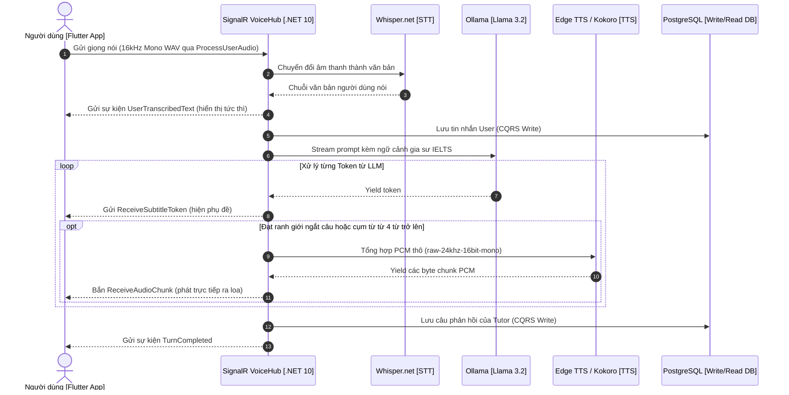

# 🎙️ AI English Tutor — Real-time Voice-to-Voice AI Tutoring System

Hệ thống gia sư tiếng Anh thông minh hỗ trợ giao tiếp hai chiều thời gian thực (Real-time Voice-to-Voice) với độ trễ cực thấp (< 1 giây). Ứng dụng mô phỏng cuộc trò chuyện tự nhiên như gọi điện với gia sư bản xứ chuẩn IELTS 8.5+, hỗ trợ sửa lỗi ngữ pháp, gợi ý từ vựng và chấm điểm theo khung tham chiếu Châu Âu (CEFR).

---

## 📑 Mục lục
- [Tổng quan kiến trúc](#-tổng-quan-kiến-trúc)
- [Tính năng nổi bật](#-tính-năng-nổi-bật)
- [Công nghệ sử dụng](#-công-nghệ-sử-dụng)
- [Cấu trúc mã nguồn](#-cấu-trúc-mã-nguồn)
- [Yêu cầu hệ thống](#-yêu-cầu-hệ-thống)
- [Hướng dẫn cài đặt & Khởi chạy](#-hướng-dẫn-cài-đặt--khởi-chạy)
  - [1. Hạ tầng phụ trợ (Docker)](#1-khởi-động-hạ-tầng-phụ-trợ-docker)
  - [2. Cài đặt mô hình AI (Ollama)](#2-chuẩn-bị-llm-ollama)
  - [3. Chạy Backend API (.NET 10)](#3-chạy-backend-net-10)
  - [4. Chạy Mobile App (Flutter)](#4-chạy-ứng-dụng-mobile-flutter)
- [Cơ chế Real-time Voice Pipeline](#-cơ-chế-real-time-voice-pipeline)
- [API & SignalR Reference](#-api--signalr-reference)
- [Troubleshooting & Lưu ý](#-troubleshooting--lưu-ý)

---

## 🏛️ Tổng quan kiến trúc

Dự án được xây dựng theo mô hình Monorepo gồm 2 thành phần chính:
- **Backend**: Xây dựng bằng **.NET 10** theo chuẩn **Clean Architecture** kết hợp mô hình **CQRS (MediatR)** và **SignalR Hub** quản lý kết nối thời gian thực.
- **Mobile**: Ứng dụng **Flutter (iOS/Android/macOS)** thiết kế theo **Clean Architecture** kết hợp **BLoC pattern**, truyền phát âm thanh phần cứng trực tiếp qua PCM buffer.

### Sơ đồ luồng xử lý giọng nói (Real-time Audio Pipeline)



---

## ✨ Tính năng nổi bật

1. **Giao tiếp giọng nói thời gian thực (Full-Duplex Voice-to-Voice)**:
   - Độ trễ phản hồi cực thấp (< 1s) nhờ kiến trúc **PCM Streaming** trực tiếp tới tầng phần cứng của thiết bị, không cần đợi sinh hết câu hay lưu file đệm trung gian.
2. **Cơ chế ngắt lời thông minh (Barge-in Support)**:
   - Người dùng có thể nhấn nói đè hoặc bắt đầu lượt nói mới bất cứ lúc nào; hệ thống sẽ hủy ngay lượt sinh âm thanh cũ thông qua `CancellationToken` và xóa buffer âm thanh client để phản hồi lượt nói mới tức thì.
3. **Sửa lỗi và hướng dẫn phản xạ tự nhiên (Pedagogical Prompting)**:
   - Prompt gia sư đạt chuẩn IELTS 8.5+, câu trả lời súc tích (1-3 câu), tự nhiên kèm mẹo sửa lỗi ngữ pháp/từ vựng nhẹ nhàng trong ngoặc đơn: `(Tip: Instead of "...", you can say "...")`.
4. **Phân loại trình độ theo chuẩn CEFR**:
   - Hỗ trợ các cấp độ từ **A1, A2, B1, B2, C1 đến C2**, tự điều chỉnh từ vựng và tốc độ giao tiếp phù hợp với người học.
5. **Chạy hoàn toàn cục bộ / bảo mật dữ liệu (On-Premise / Privacy-First)**:
   - STT chạy bằng mô hình **Whisper local** (Whisper.net tự động tải và cache model GGML).
   - LLM chạy trực tiếp qua **Ollama** trên máy (Llama 3.2).
   - Hỗ trợ cả **Edge TTS** (chất lượng cao) lẫn **Kokoro TTS** (chạy Docker local).
6. **Báo cáo & Tổng kết buổi học (Session Summary)**:
   - Lưu trữ toàn bộ lịch sử hội thoại, phân tích tiến độ, hiển thị đánh giá tổng kết sau khi kết thúc buổi luyện nói.

---

## 🛠️ Công nghệ sử dụng

### Backend (.NET 10)
| Công nghệ | Mục đích |
|---|---|
| **.NET 10 Web API** | Nền tảng backend hiệu năng cao, RESTful APIs |
| **Clean Architecture** | Phân tách lớp: `Domain`, `Application`, `Infrastructure`, `Persistence`, `API` |
| **MediatR (CQRS)** | Tách biệt luồng Ghi (Commands) và Đọc (Queries) |
| **ASP.NET Core SignalR** | WebSocket real-time hub xử lý audio & token streaming |
| **Whisper.net** | Nhận dạng giọng nói (STT) sử dụng model Whisper GGML chạy native |
| **OllamaSharp** | Giao tiếp streaming với máy chủ Ollama LLM cục bộ |
| **Npgsql & EF Core 10** | Tương tác cơ sở dữ liệu PostgreSQL (Write Context & Read Context) |
| **Serilog** | Ghi log có cấu trúc (Structured Logging) kèm Tracing ID |
| **Scalar** | Giao diện tài liệu API hiện đại thay thế Swagger UI (`/scalar/v1`) |

### Mobile (Flutter)
| Thư viện | Mục đích |
|---|---|
| **Flutter 3.x / Dart 3** | Ứng dụng di động đa nền tảng (iOS, Android, macOS) |
| **flutter_bloc** | Quản lý trạng thái (State Management) theo kiến trúc BLoC |
| **get_it** | Dependency Injection container |
| **record** | Thu âm microphone chuẩn định dạng WAV 16kHz Mono 16-bit |
| **flutter_pcm_sound** | Truyền phát mẩu dữ liệu PCM 24kHz trực tiếp vào buffer âm thanh phần cứng |
| **signalr_netcore** | Kết nối SignalR WebSocket tới backend |
| **dio & pretty_dio_logger** | Client HTTP gọi REST API |
| **flutter_animate** | Hiệu ứng UI, sóng âm thanh (Audio Wave Visualizer) |

---

## 📁 Cấu trúc mã nguồn

```text
ai-english-tutor/
├── backend/
│   ├── src/
│   │   ├── AiEnglishTutor.Domain/          # Entity, Enum (LearningSession, SessionMessage, CefrLevel, ...)
│   │   ├── AiEnglishTutor.Application/     # CQRS Commands, Queries, Interfaces, DTOs
│   │   ├── AiEnglishTutor.Infrastructure/  # Whisper STT, Ollama LLM, Edge & Kokoro TTS, Prompts
│   │   ├── AiEnglishTutor.Persistence/     # EF Core, PostgreSQL DbContext (Write/Read), Repositories
│   │   └── AiEnglishTutor.API/             # Controllers, SignalR VoiceHub, Program.cs, Scalar OpenApi
│   ├── docker-compose.yml                  # Khởi chạy PostgreSQL 16 & Kokoro TTS
│   ├── AiEnglishTutor.sln                  # Visual Studio / Rider Solution file
│   ├── CODE_REVIEW.md                      # Báo cáo đánh giá chất lượng mã nguồn & bảo mật
│   └── PCM_STREAMING_PLAN.md               # Thiết kế chi tiết kỹ thuật PCM Streaming Backend
│
└── mobile/
    ├── lib/
    │   ├── app/                            # Cấu hình MaterialApp, Routing, Global Providers
    │   ├── core/                           # Audio service, SignalR service, Constants, Theme, DI
    │   └── features/
    │       ├── session/                    # Chọn chủ đề, chọn cấp độ CEFR, xem tổng kết buổi học
    │       └── voice_tutor/                # Giao diện gọi thoại, Push-to-Talk, sóng âm, Subtitle stream
    ├── pubspec.yaml                        # Danh sách dependencies Flutter
    └── PCM_STREAMING_PLAN.md               # Thiết kế chi tiết kỹ thuật PCM Streaming Mobile
```

---

## 💻 Yêu cầu hệ thống

- **Hệ điều hành**: macOS, Linux hoặc Windows 11.
- **.NET SDK**: Phiên bản `.NET 10.0` trở lên.
- **Flutter SDK**: Phiên bản `>= 3.3.1` (kèm Xcode cho iOS/macOS hoặc Android Studio cho Android).
- **Docker & Docker Compose**: Để chạy cơ sở dữ liệu PostgreSQL và TTS server.
- **Ollama**: Đã cài đặt trên máy và có sẵn model `llama3.2:latest` (hoặc model tùy chọn khác).

---

## 🚀 Hướng dẫn cài đặt & Khởi chạy

### 1. Khởi động hạ tầng phụ trợ (Docker)

Di chuyển vào thư mục `backend/` và khởi động container PostgreSQL:

```bash
cd backend
docker compose up -d
```

> **Ghi chú**: Lệnh trên sẽ khởi chạy:
> - **PostgreSQL 16**: Port `5433` (Username: `postgres`, Password: `postgrespassword`, DB: `ai_tutor_db`).
> - **Kokoro TTS (CPU)**: Port `8880` (Tùy chọn Text-To-Speech offline).

Kiểm tra container đang chạy:
```bash
docker compose ps
```

---

### 2. Chuẩn bị LLM (Ollama)

Đảm bảo Ollama daemon đang chạy ở cổng mặc định `http://127.0.0.1:11434`, sau đó tải mô hình Llama 3.2:

```bash
# Tải model (chỉ cần chạy lần đầu)
ollama pull llama3.2

# Kiểm tra model hoạt động
ollama run llama3.2 "Hello"
```

---

### 3. Chạy Backend (.NET 10)

1. Cấu hình kiểm tra trong `backend/src/AiEnglishTutor.API/appsettings.json`:
   ```json
   {
     "ConnectionStrings": {
       "DefaultConnection": "Host=localhost;Port=5433;Database=ai_tutor_db;Username=postgres;Password=postgrespassword"
     },
     "Ollama": {
       "Endpoint": "http://127.0.0.1:11434",
       "Model": "llama3.2:latest"
     },
     "Tts": {
       "Provider": "Edge",
       "DefaultVoice": "af_heart"
     }
   }
   ```

2. Khởi chạy API service:
   ```bash
   cd backend/src/AiEnglishTutor.API
   dotnet run
   ```

3. Backend sẽ tự động:
   - Tạo cấu trúc database PostgreSQL nếu chưa tồn tại (`EnsureCreated`).
   - Tự động tải file mô hình Whisper STT (`ggml-base.en.bin` ~140MB) vào thư mục `~/.ai-english-tutor/models/` nếu chưa có.
   - Lắng nghe HTTP & SignalR tại: `http://localhost:5129`.
   - Xem tài liệu API Scalar tại: `http://localhost:5129/scalar/v1`.

---

### 4. Chạy ứng dụng Mobile (Flutter)

1. Mở một terminal mới và di chuyển vào thư mục `mobile`:
   ```bash
   cd mobile
   flutter pub get
   ```

2. **Cấu hình địa chỉ IP máy chủ Backend**:
   - Nếu chạy trên **iOS Simulator / macOS**: Ứng dụng tự động kết nối tới `localhost:5129`.
   - Nếu chạy trên **Android Emulator**: Ứng dụng tự động dùng `10.0.2.2:5129`.
   - Nếu chạy trên **Thiết bị thật (Physical Device)**: Bạn cần truyền IP máy tính qua tham số `--dart-define`:
     ```bash
     flutter run --dart-define=BACKEND_HOST=192.168.1.xxx:5129
     ```
     *(Thay `192.168.1.xxx` bằng IP mạng nội bộ máy tính của bạn)*.

3. Khởi chạy ứng dụng:
   ```bash
   flutter run
   ```

---

## ⚡ Cơ chế Real-time Voice Pipeline

Hệ thống tối ưu độ trễ âm thanh hai chiều thông qua các kỹ thuật:

1. **Chuẩn hóa ghi âm (Client-side Recording)**:
   - Thiết bị thu âm ở tần số **16,000 Hz, 16-bit Mono WAV** thông qua package `record`. Đây là định dạng tối ưu nhất cho model Whisper Speech-to-Text mà không cần qua khâu nén/giải nén trung gian.

2. **Cắt câu theo cụm ngữ pháp (Clause-Level Chunking)**:
   - Khi Ollama stream từng token chữ, backend sẽ kiểm tra:
     - Dấu kết thúc câu: `.`, `?`, `!`, `\n`.
     - Dấu ngắt cụm câu: `,`, `;`, `:` khi cụm từ đạt tối thiểu **4 từ**.
   - Ngay khi nhận đủ một cụm, backend gửi ngay cụm từ đó sang TTS để bắt đầu tổng hợp âm thanh, giúp người dùng nghe thấy tiếng của AI chỉ sau vài trăm mili-giây kể từ khi dứt lời.

3. **Stream PCM thô (24kHz, 16-bit, Mono)**:
   - Backend sử dụng định dạng `raw-24khz-16bit-mono-pcm` từ Edge TTS. Định dạng này không có frame header phức tạp như MP3/AAC, cho phép truyền từng chunk byte nhỏ qua SignalR.
   - Backend tự động căn chỉnh bội số 2 byte (16-bit alignment) để chống rè tiếng trước khi gửi xuống Flutter.
   - Flutter sử dụng `flutter_pcm_sound` nạp trực tiếp danh sách mẫu âm thanh `Int16List` vào driver âm thanh của thiết bị.

4. **Xử lý ngắt lời (Barge-in / Turn Management)**:
   - Mỗi lượt nói được gắn một định danh `turnId` duy nhất.
   - Khi người dùng bắt đầu nói một lượt mới, backend kích hoạt hủy (`Cancel`) `CancellationToken` của lượt trước đó, dừng ngay lập tức luồng sinh chữ của LLM và luồng phát âm thanh của TTS.
   - Client tự động xóa sạch hàng đợi audio cũ, đảm bảo không bị lẫn lộn âm thanh giữa các lượt trò chuyện.

---

## 🔌 API & SignalR Reference

### REST API Endpoints

| Phương thức | Đường dẫn | Mô tả |
|---|---|---|
| `POST` | `/api/sessions` | Bắt đầu một phiên học mới (`Topic`, `TargetLevel`) |
| `GET` | `/api/sessions/{id}` | Lấy chi tiết lịch sử hội thoại của phiên |
| `GET` | `/api/sessions/active` | Lấy danh sách các phiên đang hoạt động |
| `POST` | `/api/sessions/{id}/complete` | Kết thúc phiên học kèm phản hồi tổng kết |
| `POST` | `/api/test/chat` | Kiểm tra kết nối sinh câu trả lời với Ollama |
| `POST` | `/api/test/tts` | Kiểm tra tổng hợp giọng nói WAV |

### SignalR Hub (`/hubs/voice`)

#### Client gọi lên Server:
- `StartSession(string topic, CefrLevel level)`: Mở phiên học và ghim phiên vào kết nối.
- `JoinSession(Guid sessionId)`: Ghim phiên đã có vào kết nối (sau khi reconnect).
- `ProcessUserAudio(byte[] audioBytes, Guid turnId, Guid? sessionId)`: Gửi file ghi âm giọng nói.
- `ProcessUserText(string userText, Guid turnId, Guid? sessionId)`: Gửi tin nhắn dạng văn bản.

#### Server gửi về Client:
- `StatusUpdate(string status)`: Trạng thái hiện tại ("Transcribing...", "AI is thinking...").
- `UserTranscribedText(string text)`: Văn bản mà STT nhận dạng được từ giọng nói user.
- `ReceiveSubtitleToken(string token, Guid turnId)`: Từng từ/token phản hồi của AI để hiển thị phụ đề thời gian thực.
- `ReceiveAudioChunk(byte[] pcmChunk, Guid turnId)`: Gói âm thanh PCM thô để nạp vào loa.
- `TurnCompleted(string fullResponse)`: Hoàn thành lượt phản hồi hiện tại.

---

## ❓ Troubleshooting & Lưu ý

1. **Lỗi không nghe thấy âm thanh trên máy ảo / thiết bị thật**:
   - Kiểm tra xem bạn đã cấp quyền truy cập Microphone cho ứng dụng hay chưa.
   - Trên iOS: Đảm bảo thiết bị không bật chế độ im lặng (Silent Switch).
2. **Lỗi kết nối SignalR / HTTP từ điện thoại thật**:
   - Đảm bảo điện thoại và máy tính cùng kết nối vào một mạng Wi-Fi.
   - Tắt hoặc mở cổng tường lửa máy tính cho port `5429` / `5129` / `5433`.
   - Sử dụng flag `--dart-define=BACKEND_HOST=<IP_LAN>:5129` khi chạy `flutter run`.
3. **Mô hình Whisper tải chậm ở lần đầu tiên**:
   - Ở lần chạy đầu tiên, backend sẽ tải file `ggml-base.en.bin` (~140MB). Vui lòng đợi đến khi terminal hiện thông báo `Whisper model downloaded successfully` trước khi thực hiện cuộc gọi.
4. **Ollama không phản hồi**:
   - Kiểm tra `curl http://127.0.0.1:11434/api/tags` xem Ollama service đang chạy và model `llama3.2:latest` đã sẵn sàng hay chưa.

---

## 📄 Giấy phép

Dự án được phát triển phục vụ mục đích nghiên cứu, học tập và ứng dụng AI trong giáo dục ngôn ngữ.
